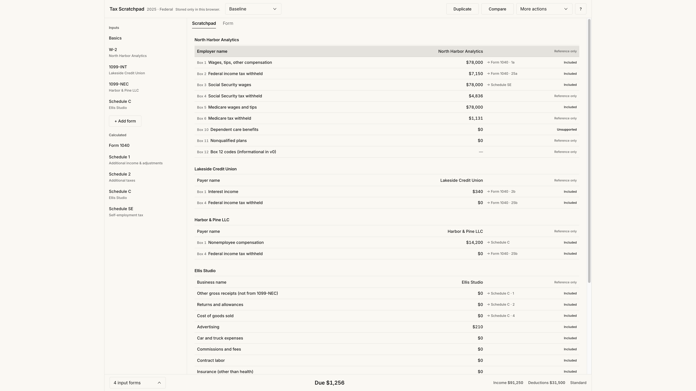
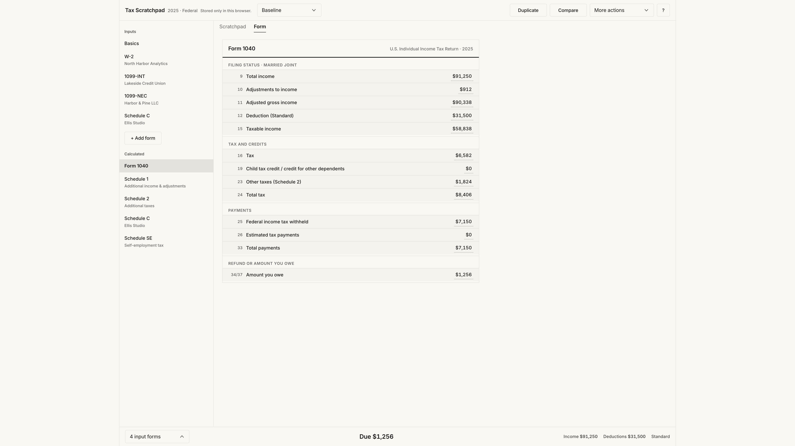
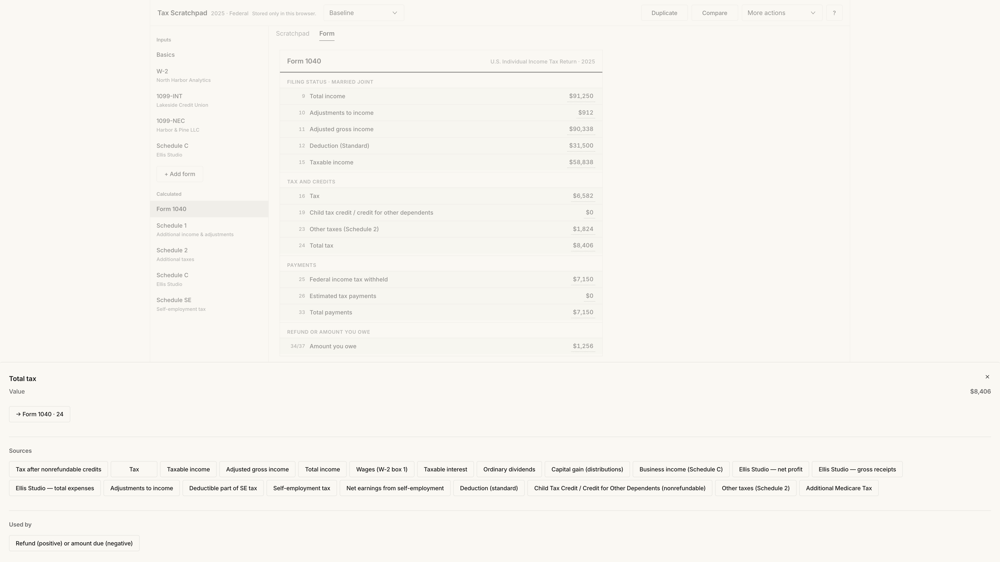
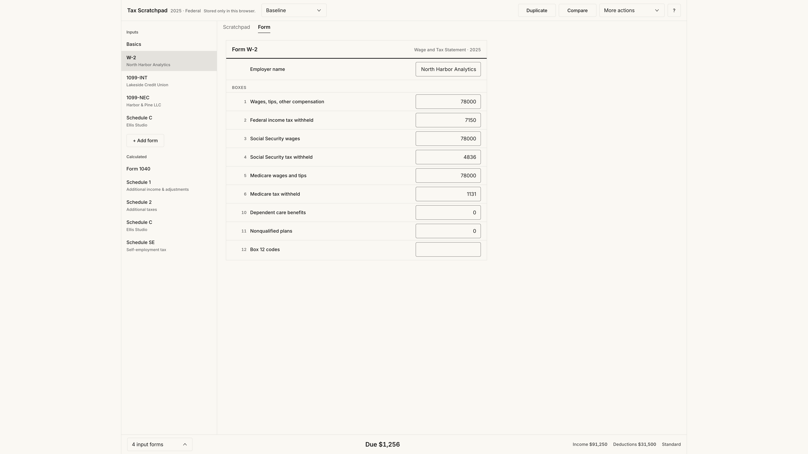
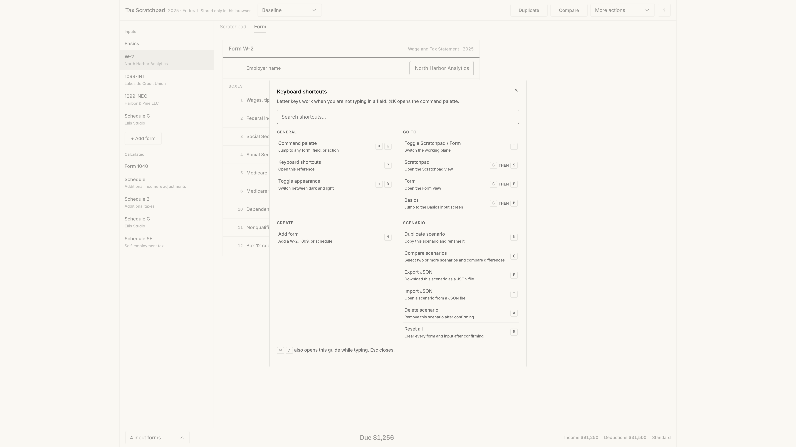

# Tax Scratchpad

A local-first workspace for exploring hypothetical **2025 U.S. federal** tax scenarios. You edit source forms directly, the engine recalculates the return, and you can inspect how each figure was produced.

This is experimental software for scenario exploration. It does not prepare or file tax returns and is not tax advice.

**Live demo:** [taxscratchpad.npux.design](https://taxscratchpad.npux.design)

## Why it exists

Most tax software hides the return behind an interview. Tax Scratchpad treats a return as a packet of source documents and derived forms you can inspect and edit.

The product bets on:

- Direct manipulation instead of a wizard
- Source forms and calculated forms in the same packet
- Transparent calculation provenance
- Scenario duplication and side-by-side comparison
- Keyboard-first interaction
- Local-only persistence

## Features

- **Scratchpad** — a dense, keyboard-navigable field list. Each row shows the value, where it maps on the return, and whether it is counted, reference-only, or unsupported.
- **Form view** — IRS-style line layouts for W-2, 1099-INT/DIV/NEC, Schedule C, Schedule A, Form 1040, and the derived schedules the engine produces.
- **2025 federal engine** — wages, interest, dividends, Schedule C / SE, itemized vs standard deduction, qualified dividends / capital gain distributions, additional Medicare tax, and Child Tax Credit / ACTC (Schedule 8812).
- **Coverage gating** — refund / amount due is shown only when every populated field is in the supported rule set. Unsupported inputs (age 65+, blindness, depreciation, home office, and other triggers) hide the projection instead of guessing.
- **Calculation traces** — click a derived amount to walk ancestors, breakdowns, and downstream uses.
- **Scenarios** — create, duplicate, rename, import/export JSON, and compare differences only.
- **Keyboard model** — Linear-style unmodified letters (`N`, `D`, `C`, `T`), `G` then `S`/`F`/`B` chords, `⌘K` command palette, `?` shortcut overlay.

On first visit, if no scenarios are saved, a fictional **Baseline** demonstration is created (W-2 wages, bank interest, and a small Schedule C linked to a 1099-NEC). **More actions → Reset demo** loads a fresh copy without overwriting existing scenarios.

## Screenshots

All screenshots are from the running app using the fictional Baseline demonstration.

**Scratchpad.** Source forms as a single working list: box numbers, destinations, and inclusion status.



**Form 1040.** Calculated return with live totals in the persistent footer.



**Calculation trace.** Clicking total tax opens sources, destinations, and downstream uses.



**W-2 form editor.** Direct box editing with the same packet rail and projection bar.



**Keyboard shortcuts.** Searchable overlay; the same catalog drives the command palette and the listener.



## Stack

| Layer | Choice |
| --- | --- |
| UI | React 19, TypeScript, Vite 8 |
| Design system | [Vlak](https://github.com/Noord-Ventures/vlak) (`@noorddev/vlak-react`) |
| Persistence | IndexedDB via [`idb`](https://github.com/jakearchibald/idb) |
| Tests | Vitest |
| Lint | oxlint |
| Hosting | Cloudflare Pages (static `dist/`) |

There is no backend, no account, and no tax API. Scenario data never leaves the browser. The Pages deployment only serves the static bundle.

## Architecture

```
src/
  tax/            Pure 2025 federal calculation engine
    money.ts      Integer cents + IRS whole-dollar rounding
    graph.ts      Provenance graph (ancestors / descendants)
    2025/         Rule modules, tax table, coverage scan
  state/          Scenario reducer + React store
  storage/        IndexedDB, JSON import/export, schema version
  forms/          Field definitions + IRS-style renderers
  comparison/     Scenario diff (calculations and inputs)
  components/     Shell, scratchpad, packet, overlays
  app/            Hotkeys, command palette, theme, I/O
  fixtures/       Fictional demo + IRS tax-table regression
```

The calculation is a pure function: `calculateFederal2025(scenario) → { coverage, totals, forms, graph }`. The store memoizes that result for the active scenario and persists edits with a 300ms debounce.

Two views share one selection model. The packet rail lists **Inputs** (Basics plus source forms) and **Calculated** forms that appear only when they have work to do. Scratchpad treats a null selection as “all inputs”; Form view falls back to Form 1040 rather than an empty pane.

### Engineering decisions worth reading

- **Integer cents** throughout (`src/tax/money.ts`). Display uses IRS whole-dollar rounding; editing parses `$1,234.56`, `(1,234.56)`, and similar input.
- **Tax table vs worksheet.** Taxable income under $100,000 uses a generated 2025 tax table (midpoint method). At $100,000 the engine switches to the Tax Computation Worksheet. Zero taxable income is forced to `$0`, not the `$0–$50` midpoint row. See `src/tax/2025/ordinary-tax.ts` and `scripts/generate-tax-table.mjs`.
- **Coverage before confidence.** The engine still computes a full result when coverage is incomplete, so traces remain useful for debugging. The footer must not show refund/due unless `coverage.status === 'exact'` (`src/tax/2025/coverage.ts`, `src/components/ReturnFooter.tsx`).
- **Provenance graph.** Each derived line records inputs, kind, destination, and optional IRS authority. The trace drawer walks that graph instead of restating a formula in prose.
- **Diff-only comparison.** `compareScenarios` aligns forms by employer/payer/business name, emits only rows that differ, and describes refund/due changes in tax language (“$X more due”, “now a $Y refund”) rather than a signed delta on a signed number.
- **Keyboard catalog as source of truth.** Overlay, command palette, and the capture-phase listener all read `SHORTCUTS` in `src/app/hotkeys.ts`. Letters do not fire while typing; `⌘K` and `⌘/` still do.

### Design system

Vlak supplies paper/ink surfaces, hairline dividers, and selected states as a full fill or weight change rather than a leading stripe.

The product extends Vlak only where it has to. The persistent return bar opens a menu upward via a local `DropdownMenu` wrapper (`side="top"`). That drop-up is a product-specific extension, not an official Vlak component.

## Project maturity

This is a working personal prototype with a real static deployment, unit tests around the tax engine and comparison logic, and an intentional privacy model. It is not a filing product, not a multi-user system, and not a complete 1040.

Known limits, all visible in the code:

- Federal 2025 only; no states, no AMT, no estimated-tax penalty, no Form 4562 / home office
- Additional standard deduction for age 65+ and blindness is explicitly unsupported
- Git history is three commits on one day, plus later local appearance work
- `@playwright/test` is in `package.json` but there are no Playwright specs
- Production JS bundle is a single ~610 kB chunk (gzip ~151 kB)

Deployment notes are in [`DEPLOYMENT.md`](./DEPLOYMENT.md).

## Local setup

Requires Node **20.19+** or **22.12+** (Vite 8). npm is the package manager. No environment variables.

```sh
npm install
npm run dev
```

Then open the printed local URL (Vite defaults to `http://localhost:5173/`).

```sh
npm run typecheck
npm test
npm run lint
npm run build
npm run preview
```

Keyboard shortcuts when you are not typing in a field: `⌘/Ctrl+K` command palette, `?` shortcut overlay, `⇧D` appearance, `G` then `S`/`F`/`B` for Scratchpad / Form / Basics, `N` add form, `D` duplicate, `C` compare. Esc closes overlays.

Appearance defaults to dark and is stored in this browser. `⇧D` switches between dark and light.

## Privacy

Scenario and taxpayer data stay in this browser (IndexedDB database `tax-scratchpad`). Cloudflare Pages serves the static bundle only. `public/_headers` sets a Content-Security-Policy with `connect-src 'none'` so the client cannot call out at runtime.

The Baseline fixture uses invented names and amounts. It does not embed SSNs or street addresses.

## License

MIT. See [LICENSE](./LICENSE).

## Disclaimer

Experimental software for hypothetical tax scenarios. It does not prepare or file tax returns and is not tax advice.
